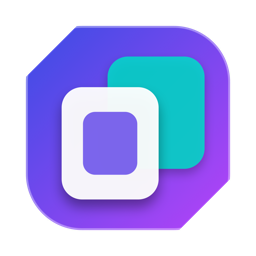
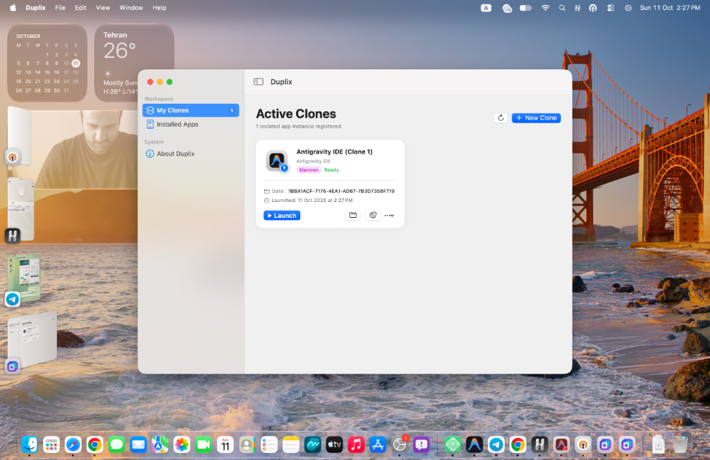

# Duplix

<p align="center">
  
  <br>
  <b>The Free, Native, Open-Source macOS App Cloner</b><br>
  Run multiple fully isolated instances of any macOS app simultaneously with independent accounts, data, and Dock icons.
  <br><br>
  <a href="https://businessmanshah-a11y.github.io/Duplix/"></a>
  <a href="https://github.com/businessmanshah-a11y/Duplix/releases"></a>
  <a href="https://github.com/businessmanshah-a11y/Duplix/blob/main/LICENSE"></a>
</p>

---

<p align="center">
  
</p>

---

## ✨ Features

- **🔊 Voicofski AI Voice & Translate (v1.4.0):** Select text anywhere on macOS (`>= 3` chars) to pop up a subtle two-stage icon-only trigger (Direct Voice or 6-language Translate with in-app review), powered by Google AI Studio (`gemini-3.8-flash-tts` with `Lora` & `Bodi` voices), macOS Keychain multi-key auto-failover (`09:00 UTC` daily reset), a floating **Notch HUD Player** with waveform & seekbar, persistent audio History, and automatic Playback & Pending Quota Queues.
- **🚀 Simultaneous Instances:** Run 2, 3, 5, or more copies of any app at the same time without conflicts.
- **🎙️ Native Integrated Voice Memo (v1.3.0):** Built directly into Duplix (no nested helper app!) with a global `⌥⌘` shortcut, fullscreen-ready floating waveform HUD, automatic `⌘V` chat attachment, live Microphone & Accessibility health checks, and background Launch at Login.
- **🔒 Deep Multi-Layer Isolation (v1.2.0):** Each clone gets its own dedicated macOS Keychain (`duplix.keychain-db`), isolated `HOME` / `CFFIXED_USER_HOME` / `GEMINI_DIR`, unique `CFBundleURLSchemes`, data directory, cookies, and cache — keeping Electron and Go-keyring accounts (like Antigravity IDE & Antigravity 2.0) 100% independent while bridging `.ssh` and `.gitconfig`.
- **⚡️ Zero Extra Disk Space:** Leverages **APFS Copy-on-Write (CoW)** to duplicate apps instantly without consuming extra storage.
- **🎨 Distinct Dock Icons:** Color-coded badges and custom labels so you instantly recognize which project or account you are working in.
- **🛡 Apple Silicon Native:** Full ad-hoc code signing and Gatekeeper compliance for M1/M2/M3/M4 and Intel Macs.
- **💸 100% Free & Open-Source:** No subscriptions, no license keys, no trial periods.

---

## 🛠 Supported App Architectures

- **Electron / Chromium:** Antigravity IDE, VS Code, Cursor, Slack, Discord, Notion, Postman, etc.
- **Native Cocoa / AppKit:** Native macOS productivity utilities, text editors, players.
- **Gecko:** Firefox, Zen Browser, Thunderbird.
- **More engines coming soon!**

---

## 🔊 Voicofski AI Text-to-Speech & Translate (v1.4.0)

- **System-Wide Selection Trigger & In-App Composer:** Highlight any text across macOS to reveal a subtle corner icon that expands into icon-only **Speak** and **Translate** actions, or type directly inside the dedicated `Voicofski` tab.
- **6-Language Translation with Review:** Translates automatically into Persian, English, German, French, Dutch, or Arabic and opens in Duplix so you can review before generating speech.
- **Google AI Studio Multi-Key Failover:** Store multiple personal AI Studio keys securely in **macOS Keychain**. When one key hits its daily quota (`429`), Voicofski switches sequentially to the next key automatically and resets exhausted keys at `09:00 UTC`. If all keys are exhausted, requests are safely stored in the **Pending Queue**.
- **Notch HUD Floating Player:** Anchored cleanly below the MacBook notch (or top-center of your active screen), featuring a non-linear loading curve, live audio waveform, scrubbable seekbar, Replay, and automatic Playback Queue.

---

## 🎙️ Built-in Voice Memo (v1.3.0)

- **Native Integrated Voice Memo:** Built directly into `Duplix.app` with a unified macOS permission identity and unified Duplix menu bar controller. Features a global `⌥⌘` shortcut, fullscreen-ready floating 5-bar waveform HUD, automatic `⌘V` chat attachment, live Microphone & Accessibility health checks, and silent background **Start at macOS Login**.

---

## 📁 Documentation

Detailed documentation and technical architecture reports are available in the [`docs/`](./docs) directory:

- [Voicofski Feature Specification (v1.4.0)](./docs/VOICOFSKI_FEATURE_SPEC.md)
- [Technical Architecture & Feasibility Report](./docs/FEASIBILITY_AND_ARCHITECTURE.md)
- [Roadmap & 5-Phase Plan](./docs/ROADMAP_AND_PHASES.md)

---

## 🏗 Development Status

All core development phases are **100% Completed & Verified**:
- **Phase 1 (Core Engine & CLI):** ✅ Completed & Verified (100% automated test coverage)
- **Phase 2 (Icon Badging & Dock Distinction):** ✅ Completed & Verified (CoreGraphics + iconutil)
- **Phase 3 (SwiftUI Native App & Dashboard):** ✅ Completed & Verified (`swift run DuplixApp`)
- **Phase 4 (Multi-App QA & Hardening):** ✅ Completed & Verified (Chromium, Electron, Gecko, Native)
- **Phase 5 (Packaging, Voice Memo & Voicofski v1.4.0):** ✅ Completed & Verified (`dist/Duplix-1.4.0.dmg`, 22 automated tests)

---

## 📦 Installation & Releases

### Option 1: Apple Disk Image (DMG)
Download the latest `Duplix-1.4.0.dmg` from the Releases section or build it locally:
```bash
./scripts/build_dmg.sh
open dist/Duplix-1.4.0.dmg
```
Drag **Duplix.app** into your **Applications** folder.

### Option 2: Homebrew Cask
```bash
brew install --cask Casks/duplix.rb
```

### Option 3: Local CLI Installation
Install the `duplix` command-line utility into your PATH:
```bash
./scripts/install_cli.sh
```

## 🖥 Native macOS App (GUI)

Launch the modern SwiftUI interface directly:

```bash
# Launch the native macOS Duplix GUI
swift run DuplixApp
```

Features included in the Native GUI:
- **Applications Scanner:** Automatically detects all installed apps in `/Applications`, filters by engine (Electron, Gecko, Native Cocoa), and instant search.
- **Visual Clone Creator Sheet:** One-click cloning with batch quantity selector (1 to 5 clones), real-time interactive icon badge preview, preset and custom hex color pickers, and badge labels.
- **Clones Dashboard:** Live grid of all cloned apps with direct Launch, Finder Data reveal, Live Badge Editor, Session Cache Wipe, and Uninstall actions.
- **Live Badge Customizer:** Update badge colors and text on existing clones in real-time.

---

## 💻 CLI Quickstart

Build and run Duplix CLI directly using Swift:

```bash
# Clone any app instantly with APFS CoW & custom Dock badge
swift run duplix clone "/Applications/Antigravity IDE.app" --name "Antigravity Work" --badge-color green --badge-text "W"

# Dynamically update/customize Dock badge color & text without recreating
swift run duplix badge "Antigravity Work" --color purple --text "DEV"

# List all created clones, badge status, and isolated data directories
swift run duplix list

# Launch an isolated instance simultaneously with existing apps
swift run duplix launch "Antigravity Work"

# Open the clone's isolated Application Support data folder
swift run duplix data "Antigravity Work"

# Wipe session/cache for a fresh start without deleting the app
swift run duplix reset "Antigravity Work"

# Update clone(s) when the original app updates (preserves logins & extensions)
duplix update --all

# Upgrade existing clones with isolated Keychain, HOME, and URL schemes without losing data
duplix repair --all

# Delete a clone cleanly
swift run duplix delete "Antigravity Work"

# Run automated test suite (22 automated unit & integration tests)
swift run DuplixTests
```

---

## 📄 License

MIT License. Free for everyone.
