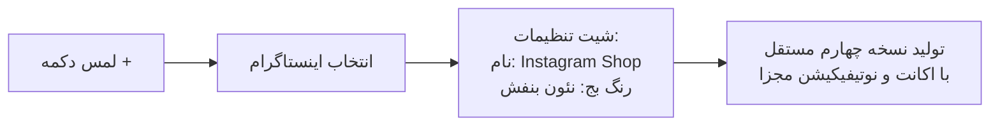

# سند جامع طراحی رابط و تجربه کاربری (UI/UX Spec) — Duplix Mobile

> **محصول:** Duplix Mobile (Android & iOS)  
> **موضوع:** معماری تجربه کاربری (UX)، دیزاین سیستم بصری (UI) و جریان‌های تعاملی (User Flows)  
> **هدف:** اجرای همزمان چند اپلیکیشن (مانند ۴ اکانت مستقل اینستاگرام، تلگرام، واتس‌اپ)، دستیار هوشمند Voicofski و یادداشت صوتی Voice Memo.

---

## ۱. هویت بصری و دیزاین سیستم (Visual Identity & Design System)

برای حفظ هماهنگی کامل با نسخه دسکتاپ مک و وب‌سایت، نسخه موبایل بر پایه تم **Dark Luxury Glassmorphism** طراحی می‌شود:

```
┌─────────────────────────────────────────────────────────────┐
│                   پالت رنگی موبایل (Palette)                │
├───────────────────┬─────────────────────────────────────────┤
│ Base Background   │ #06070B (مشکی عمیق با حداقل مصرف اولد)   │
│ Card Surface      │ #0C0E17 (سورمه‌ای کدر با بوردر شیشه‌ای) │
│ Brand Accent      │ Gradient: #4F46E5 ➔ #7C3AED ➔ #06B6D4    │
│ Active / Emerald  │ #10B981 (وضعیت فعال و لایو)              │
│ Alert / Amber     │ #F59E0B (هشدارها و فریز)                │
└───────────────────┴─────────────────────────────────────────┘
```

---

## ۲. معماری ناوبری موبایل (Information Architecture & Navigation)

اپلیکیشن موبایل از الگوی استاندارد **Bottom Navigation Bar (۳ تب اصلی)** با هپتیک فیدبک هوشمند بهره می‌برد:

```
┌─────────────────────────────────────────────────────────────┐
│                        [ Top Bar ]                          │
│   [Duplix Logo]          [Search]        [Settings / Keys]  │
├─────────────────────────────────────────────────────────────┤
│                                                             │
│                                                             │
│                      [ Content Area ]                       │
│                                                             │
│     (تب انتخابی: Clones  یا  Voicofski  یا  Voice Memo)     │
│                                                             │
│                                                             │
├─────────────────────────────────────────────────────────────┤
│                 [ Bottom Navigation Bar ]                   │
│   [📱 Clones]            [🔊 Voicofski]      [🎙️ Memo]      │
└─────────────────────────────────────────────────────────────┘
```

---

## ۳. بررسی تب‌ها و جریان‌های کاربری (Core Screens & User Flows)

### تب ۱: مدیریت و کلونینگ اپلیکیشن‌ها (Clones Hub)

این بخش مهم‌ترین نیاز کاربر (مثلاً داشتن ۴ اینستاگرام، ۳ واتس‌اپ یا ۲ تلگرام) را مدیریت می‌کند.

#### المان‌های صفحه:
1. **داشبورد کلون‌های فعال (Active Clones Grid):**
   - کارت‌های شیشه‌ای بزرگ برای هر کلون.
   - **آیکون برنامه با نشان رنگی متمایز:** برای مثال آیکون اینستاگرام با برچسب کوچک نئونی گوشه آیکون (مثلاً `Work`، `Shop`، `Personal`، `Client 1`).
   - **دکمه اجرای سریع (One-Tap Launch):** با لمس کارت، همان نسخه در سندباکس مستقل خود باز می‌شود.
   - **سوئیچ فریز (Freeze / Snooze Toggle):** خاموش کردن موقت کلون در ساعات استراحت برای قطع نوتیفیکیشن‌ها و به صفر رساندن مصرف باتری.
2. **دکمه شناور ایجاد کلون جدید (`+ Floating Action Button`):**
   - با لمس این دکمه، لیست تمام برنامه‌های نصب‌شده روی گوشی باز می‌شود (با فیلتر سریع: Social, Messaging, Tools).
   - انتخاب برنامه ➔ باز شدن **Clone Customizer Bottom Sheet**:
     - انتخاب نام سفارشی (مثلاً: `Instagram Shop`)
     - انتخاب پالت رنگی بج (سبز، بنفش، آبی، نارنجی یا رنگ دلخواه)
     - پیش‌نمایش زنده آیکون نهایی با برچسب
     - دکمه `Create Clone` (در کسری از ثانیه اضافه می‌شود).



---

### تب ۲: دستیار هوشمند صوتی و ترجمه (Voicofski Mobile)

روی موبایل کاربران به موس دسترسی ندارند، بنابراین تجربه کاربری Voicofski با الگوهای تعاملی لمسی بازطراحی شده است:

#### روش‌های فراخوانی در موبایل:
1. **پاپ‌آپ سیستمی (System-wide Selection Trigger):**
   - در اندروید: هنگام هایلایت هر متنی در کروم، واتس‌اپ یا اینستاگرام، در کنار گزینه‌های `Copy / Share`، دکمه شیک **`Duplix Voice`** ظاهر می‌شود.
   - در iOS: اشتراک مستقیم از طریق منوی بومی **`Share Sheet ➔ Voicofski`**.
2. **پخش‌کننده شناور پایین صفحه (Mini Notch Floating Player):**
   - هنگام تولید صوت، یک پلیر ظریف شیشه‌ای از پایین صفحه بالا می‌آید (مشابه Apple Music یا Spotify).
   - شامل شکل‌موج زنده (Waveform)، اسکرول زمانی، تغییر سرعت (1x, 1.25x, 1.5x) و متن ترجمه‌شده.
   - در صورت خروج از برنامه، صدا در پس‌زمینه (Background Audio) با کنترل‌های لاک‌اسکرین ادامه می‌یابد.
3. **محیط تایپ مستقیم (In-App Studio):**
   - برای ترجمه و خواندن متون طولانی با دو صدای هوش مصنوعی `Lora` (زن) و `Bodi` (مرد).

---

### تب ۳: یادداشت صوتی فوری (Voice Memo Mobile)

طراحی شده برای یادداشت‌های فکری، مکالمات و پیام‌های کاری:

#### المان‌های صفحه:
1. **دکمه مرکزی ضبط صوتی با فیدبک لرزشی (Haptic Record Button):**
   - حالت نگه‌داشتن یا لمس یک‌باره برای شروع ضبط.
   - نمایش اکولایزر ۵ خطی نئونی (دقیقاً مشابه HUD مکینتاش Duplix).
2. **ادغام با دکمه سخت‌افزاری و ویجت‌ها:**
   - **در iOS:** اتصال مستقیم به **Action Button** آیفون ۱۵ پرو و ۱۶ و ویجت کنترل‌سنتر iOS 18 (شروع ضبط با یک کلیک بدون باز کردن قفل گوشی).
   - **در اندروید:** ویجت دایره‌ای روی هوم‌اسکرین و کاشی اختصاصی در Quick Settings پنل اعلان‌ها.
3. **اشتراک‌گذاری خودکار (One-Tap Share):**
   - کپی خودکار فایل صوتی یا ارسال مستقیم به اکانت‌های کلون‌شده در تلگرام و واتس‌اپ.

---

## ۴. مقایسه تجربه کاربری اندروید و iOS

```
┌─────────────────────┬───────────────────────────┬───────────────────────────┐
│ ویژگی تعاملی        │ اندروید (Android)         │ آی‌او‌اس (iOS)            │
├─────────────────────┼───────────────────────────┼───────────────────────────┤
│ ساخت کلون اپ‌ها     │ سیستمی در هوم‌اسکرین و اپ  │ مدیریت در هوم‌اسکرین و شیت│
│ دسترسی به کلون‌ها   │ لانچر گوشی + اپلیکیشن     │ از طریق اپلیکیشن و شورتکات│
│ فعال‌سازی Voicofski │ منوی انتخاب متن (UIMenu)  │ منوی Share Sheet و Shortcuts│
│ راه‌اندازی سریع ویس  │ دکمه شناور و Quick Settings│ اکشن‌باتن و ویجت لاک‌اسکرین│
│ فریز مصرف باتری     │ خاموش‌سازی رسمی WorkProfile│ مدیریت سشن در اپ          │
└─────────────────────┴───────────────────────────┴───────────────────────────┘
```

---

## ۵. نقشه راه و گام بعدی دیزاین (Design Action Items)

1. طراحی پروتوتایپ کامپوننت‌های شیت ساخت کلون (Clone Sheet) و مینی‌پلیر شناور.
2. آماده‌سازی پکیج آیکون‌های وکتور برای تم‌های تیره موبایل.
3. پیاده‌سازی لایه مشترک رابط کاربری در قالب استانداردهای Flutter / Mobile.
