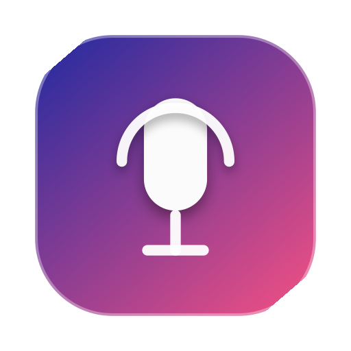

# 🎙️ Duplix Voice Memo

<p align="center">
  
  <br>
  <b>Lightweight, Native macOS Floating Voice Recorder for AI Chat & IDEs</b>
</p>

---

## ✨ Features

- **🚀 Instant Global Hotkey:** Press **`⌥ ⌘`** (Option + Command) or click the menu bar `🎙️` icon anytime.
- **🪄 Auto-Attach to Chat:** When you stop recording, it automatically attaches the audio file directly into your focused chat input (Antigravity IDE, Cursor, Slack, etc.) via clipboard paste.
- **💎 Sleek Floating Pill:** Minimalist translucent HUD panel with live dancing waveform bars and timer.
- **🎙️ Studio AAC Audio:** Compressed `.m4a` audio that sounds crystal clear while using less than 100 KB for typical voice memos.
- **⚡️ Zero Dependencies:** Pure Swift 6 with AppKit and AVFoundation. No Python, no Node, no Electron bloat.

---

## 🛠 Build & Install

Run the automated build script:

```bash
chmod +x scripts/voice_memo/build.sh
./scripts/voice_memo/build.sh
```

To install into your user applications:

```bash
mkdir -p ~/Applications
cp -R scripts/voice_memo/VoiceMemo.app ~/Applications/
open ~/Applications/VoiceMemo.app
```

---

## ⌨️ Controls & Shortcuts

| Action | Shortcut / Trigger |
| :--- | :--- |
| **Start / Stop Recording** | **`⌥ ⌘`** (Option + Command) or `⌥ ⌘ V` / `⌥ ⌘ Space` |
| **Menu Bar Trigger** | Click the `🎙️` icon in the macOS menu bar |
| **Cancel Recording** | Press `Escape` (Esc) or click `✕` |
